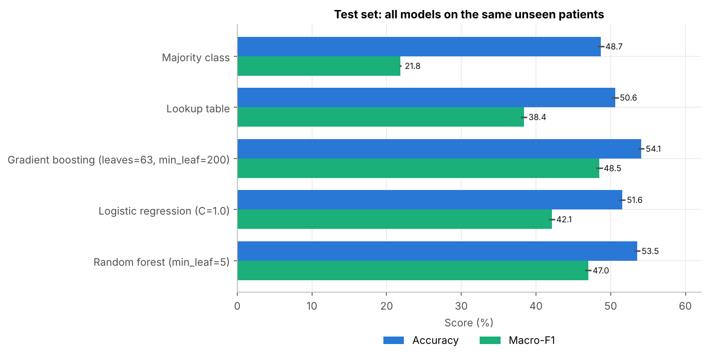
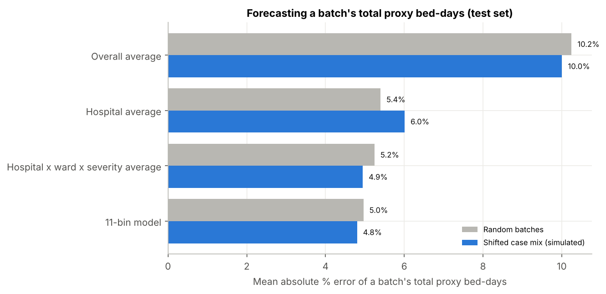
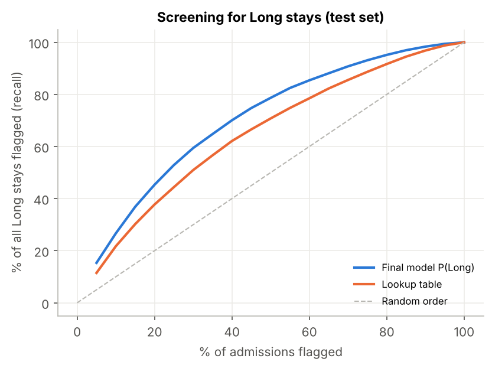

# Predicting Hospital Length of Stay at Admission: Final Report

*Revised individual study by Shuyuan Wang, building on the TUM Programming group project (Group 2). All numbers come from the run saved in [`notebooks/LOS_study.ipynb`](notebooks/LOS_study.ipynb) and [`results/metrics.json`](results/metrics.json). Section numbers in brackets (§) refer to the notebook.*

## Executive summary

* **Question.** Using only information plausibly available at admission, how well can we predict whether a *new* patient's stay will be Short (0-20 days), Medium (21-50) or Long (more than 50), and is that useful for bed planning?
* **Design.** 318,438 labeled admissions of 92,017 patients, split **by patient** into training (60%), validation (20%) and test (20%) sets. Models and settings were chosen on the validation set; the test set was used once. `Visitors with Patient` (recording time unknown) and patient aggregates over other admissions (no dates, so they mix in future records) are **excluded** from the main model.
* **Prediction.** The selected gradient boosting model reaches **54.1% accuracy** (95% CI 53.7-54.5) and **48.5% macro-F1** (CI 48.0-48.9) on unseen patients, against 50.6% / 38.4% for a hospital × ward × severity lookup table and 48.7% / 21.8% for always predicting "Medium". The gain is real but modest: individual LOS is hard to predict from these admission fields.
* **Long stays.** Ranking admissions by predicted risk of a Long stay gives ROC-AUC **0.752** (lookup table 0.683). Flagging the top 20% of admissions captures **45.3%** of all Long stays (lookup table 37.7%; random order 20%). The predicted risk is close to the observed rate on the test set (expected calibration error 0.004).
* **Bed-day demand.** For simulated batches of 100 admissions, the model forecasts total (proxy) bed-days with **5.0%** mean absolute error, against 5.2% for the best lookup table. Its 90% simulation interval contained the actual total in 91.1% of test batches.
* **Visitors.** If `Visitors with Patient` were known at admission, accuracy would rise to 62.7% (macro-F1 62.3%). Whether that is legitimate depends on when the field is recorded, which has to be checked with the data owner.
* **Comparison with the course project.** The original project reported 61% under different conditions (random admission split, Visitors included, test-set tuning). Re-creating its random forest gives 60.5% under its own conditions. With the same information (Visitors included, patient split) the new pipeline scores 62.7% against 60.2% for the original approach. The main result of 54.1% answers a stricter question and is not directly comparable with 61%.

## 1. Business problem and objectives

Hospitals need to plan beds, staff and discharge support before they know how long patients will stay. Two decisions benefit from an early estimate:

1. **Capacity:** how many bed-days will a group of new admissions need?
2. **Discharge planning:** which new patients are likely to stay long, so that rehabilitation places, home care or step-down beds can be arranged early?

The study therefore asks three questions: how well LOS can be predicted at admission for patients not seen before (§1), which admission characteristics are associated with longer stays, and how useful the predictions are for the two decisions above in simulated settings.

## 2. Data and key assumptions

* **Data:** the course dataset (same as the public *AV Healthcare Analytics II* data): 455,495 admissions to 32 hospitals; 318,438 have a `Stay` label (11 bins of 10 days). The 137,057 unlabeled rows belong to other patients and are not used (§3).
* **Target:** Short (32% of admissions), Medium (48%) and Long (20%). For bed-days, each bin is represented by its **midpoint** (5, 15, ..., 95 days) and "More than 100 Days" by **110 days**. These proxy days are an assumption; §11.4 tests alternatives.
* **Information available at admission (assumed):** hospital and its properties, department, ward type, ward facility, bed grade, free rooms, patient city, admission type, severity, age band and deposit (14 features). We assume that ward, department and bed grade refer to the admission assignment, that severity is assessed at admission and that free rooms is a snapshot at admission. The data cannot confirm this.
* **Excluded from the main model:** `Visitors with Patient`, whose recording time is unknown; and aggregates over a patient's other admissions, because there are no dates and `case_id` is not chronological, so they mix past and future records.
* **Data quality:** `Bed Grade` is missing in 113 labeled rows (filled with the training median), `City_Code_Patient` in about 4.5k (kept as its own category). There are 65 duplicate records, all within the same patient, which are kept. Four hospital-level columns are constant within each hospital.

## 3. Methods and evaluation design

* **Split by patient.** Two admissions of the same patient have correlated stays (r = 0.32 vs 0.00 for random pairs, §4.5), so a patient in both training and test data would inflate the score. Training: 191,474 admissions (55,209 patients); validation: 63,459 (18,404); test: 63,505 (18,404).
* **No learned step sees validation or test data.** Category codes, median fills, scaling and lookup tables are all fitted on the training set.
* **Models (same split, target and features):** majority class; lookup table (training class shares per hospital × ward × severity); logistic regression (2 settings); random forest (2 settings); gradient boosting (`HistGradientBoostingClassifier`, 3 tree sizes, iteration count by early stopping on validation log-loss).
* **Selection rule fixed in advance:** highest validation macro-F1, which weights the three classes equally.
* **Test metrics:** accuracy, balanced accuracy, macro-F1, log-loss, per-class precision/recall/F1, confusion matrix, ROC-AUC and average precision for P(Long), with 95% intervals from a bootstrap that resamples patients.
* **Additional analyses, run after the design was frozen and not used for selection:** Visitors and retrospective aggregates (§9.4), a controlled comparison with the original approach (§9.5), permutation importance (§10.1), error analysis (§10.3), a reliability check of P(Long) (§10.4) and operational simulations (§11).

## 4. Results and comparison with baselines

**Validation (model selection).** The three gradient boosting settings were almost tied (macro-F1 48.6%-48.8%) and ahead of the random forest (46.9%), logistic regression (42.4%) and the lookup table (38.8%). The selected model has 63 leaves per tree, a minimum leaf size of 200 and 67 iterations.

**Test set (unseen patients):**

| Model | Accuracy (95% CI) | Macro-F1 (95% CI) | Balanced acc. | Log-loss | ROC-AUC P(Long) |
|---|---|---|---|---|---|
| Majority class | 48.7% (48.2-49.1) | 21.8% (21.7-22.0) | 33.3% | 1.033 | – |
| Lookup table | 50.6% (50.1-51.1) | 38.4% (37.9-38.8) | 40.0% | 0.984 | 0.683 |
| Logistic regression | 51.6% (51.1-52.0) | 42.1% (41.6-42.5) | 42.4% | 0.964 | 0.708 |
| Random forest | 53.5% (53.2-53.9) | 47.0% (46.5-47.4) | 46.3% | 0.939 | 0.742 |
| **Gradient boosting (final)** | **54.1%** (53.7-54.5) | **48.5%** (48.0-48.9) | 47.6% | 0.927 | **0.752** |

The final model beats the random forest by +1.5 macro-F1 points (paired 95% CI +1.1 to +1.8) and the lookup table by +10.1 points (+9.5 to +10.6).

**Per class (final model):** Short: precision 52%, recall 38%; Medium: 56% / 74%; Long: 49% / 31%. The model predicts "Medium" often, so Medium recall is high and Short and Long recall are low.

**Supplementary feature sets (same model and test set, §9.4):**

| Feature set | Deployable at admission? | Accuracy | Macro-F1 | ROC-AUC P(Long) |
|---|---|---|---|---|
| Main (14 admission features) | yes | 54.1% | 48.5% | 0.752 |
| + Visitors with Patient | only if visitors are known at admission | 62.7% | 62.3% | 0.893 |
| + patient aggregates (retrospective) | no | 55.1% | 50.1% | 0.770 |
| + Visitors + all aggregates (retrospective) | no | 62.9% | 62.5% | 0.898 |

Visitors add 8.6 accuracy points; the retrospective aggregates add 1.0.

## 5. New findings and error analysis

* **Same-patient similarity.** A patient's admissions resemble each other (r = 0.32), which is why a patient-grouped split is needed for an honest estimate on new patients. In the controlled comparison, however, the original features gave almost the same score under both splits (60.5% vs 60.2%), probably because they contain little that identifies a patient. The split should matter more for features that do (such as patient aggregates), but that was not tested separately here.
* **What the model relies on (permutation importance, §10.1):** Hospital code (5.8 pp), Ward Type (4.1 pp), Admission Deposit (4.0 pp), City Code Patient (2.8 pp), Type of Admission (2.2 pp). The four hospital-level columns (Hospital type code, Hospital region code, Ward Facility Code, City Code Hospital) add nothing once `Hospital_code` is present. The deposit looks almost identical across classes on its own (§4.3) but matters in combination with hospital and ward.
* **Errors are mostly between neighbouring classes.** Of the actual Long stays, 31% are predicted Long, 56% Medium and only 12% Short (§9.2, §10.3).
* **Which Long stays are missed?** Caught Long stays are more often of extreme severity and in wards S or T; missed ones look like ordinary admissions. Long stays that do not "look long" at admission cannot be anticipated from these fields (§10.3).
* **Probabilities.** P(Long) is close to the observed rate in every decile of the test set (ECE 0.004, largest gap 1.6%; Brier 0.134 vs 0.156 for a constant). Even in the riskiest tenth of admissions the mean predicted risk is only 0.53, which is why the most-likely-class rule predicts Long for fewer admissions than are actually Long, even though the ranking is informative.
* **Visitors.** The correlation of visitors with LOS is +0.42: more visitors, longer stays. The original project reported it as negative.

## 6. Operational application and business insights

The data have no admission or discharge dates, so all of this is **simulation**, not a hospital trial.

**Bed-day demand of a batch of admissions (§11.2-11.4).** An 11-bin version of the model gives each admission a probability for each stay bin and thus an expected proxy stay. Test admissions were cut into 621 random batches of 100 within each hospital. A batch is a modelling device, not a week. Its total bed-days is the **cumulative** demand of those patients over their whole stays, not the number of beds occupied on any given day.

| Forecast of a batch's total proxy bed-days | Random batches: MAPE (bias) | Shifted case mix: MAPE (bias) |
|---|---|---|
| Overall training average | 10.2% (+1.9%) | 10.0% (-3.1%) |
| Hospital average | 5.4% (+0.9%) | 6.0% (-4.1%) |
| Hospital × ward × severity average | 5.2% (+0.8%) | 4.9% (-0.3%) |
| 11-bin model | **5.0%** (+0.4%) | **4.8%** (-0.1%) |

* The model's 90% simulation interval was checked on 618 validation batches first (90.5% coverage, so no adjustment was needed). It covered 91.1% of random test batches and 91.8% of shifted ones.
* With other proxy-day assumptions, batch totals change (mean 2,785-3,777 bed-days), but the model stays ahead of the lookup table in every variant (model MAPE 4.8-5.7%; lookup 5.0-6.0%).

**Long-stay screening (§11.5):**

| Flagged share of admissions | Long stays captured: model | Lookup table | Precision: model | Lift: model | Share of proxy bed-days in the flagged group |
|---|---|---|---|---|---|
| 10% | 26.7% | 21.7% | 51.5% | 2.7 | 15.6% |
| 20% | 45.3% | 37.7% | 43.7% | 2.3 | 28.4% |
| 30% | 59.4% | 51.0% | 38.2% | 2.0 | 39.7% |

**Business insights**

*(a) What the experiment found*
* From admission data alone, individual LOS can be predicted only modestly better than "what usually happens in this hospital, ward and severity group".
* The model's main added value is **ranking**: it concentrates Long stays in a small review list clearly better than the lookup table.
* For cumulative bed-day demand of groups of 100 admissions, simple group averages are already good (about 5% error); the model reduces the error by about 5% relative, and its 90% range was well covered in the simulation.
* Adding `Visitors with Patient` would improve accuracy more than any other change tested (8.6 points), but only if it is truly known at admission.

*(b) Actions a manager could consider*
* Use the risk ranking to choose which new admissions a discharge-planning team reviews first, with review capacity set by the team, e.g. 10-20% of admissions.
* Use group-level bed-day forecasts with their simulation range as a planning input alongside existing averages, not instead of clinical judgement.
* Find out when `Visitors with Patient` and the other fields are recorded. If visitors are known at admission, the higher-accuracy variant becomes usable.

*(c) What has to be validated before real use*
* The timing of every input in the hospital's information systems, especially ward, severity and visitors.
* Performance on recent data and at other hospitals (this study uses one historical dataset and a random patient split, not a split by time).
* Real occupancy simulation with admission and discharge dates, which this dataset lacks.
* Whether acting on the screening list actually shortens stays or frees beds. This requires a prospective evaluation; the present results show identification only, not a reduction in LOS or cost.
* Fairness and error checks for patient groups (e.g. age bands), and acceptance by clinical staff.

## 7. Limitations and next steps

**Limitations**
* Availability at admission is assumed, not verified, for several fields.
* Stays are binned, and bed-days use proxy midpoints (110 days for ">100").
* No dates: there is no temporal validation, no daily occupancy and no true "history" features.
* The model search was deliberately small (2-3 settings per family); a larger search might add a little.
* The saved results were produced with Python 3.13.17, pandas 3.0.5, scikit-learn 1.9.1, numpy 2.5.3, matplotlib 3.11.2. The code is written to also run on Python 3.8 with pandas 2.0 and scikit-learn 1.3, but it was not executed with those versions, and small numerical differences between scikit-learn versions are possible.
* The original XGBoost model was not re-run (`xgboost` was not available in the environment used for this run, and the project keeps its requirements to scikit-learn); the original random forest stands in for the original approach.

**Next steps**
1. Confirm the recording time of each field with the data owner; re-run with Visitors if appropriate.
2. Obtain admission dates to validate on later periods and to simulate daily occupancy.
3. Tune the decision rule for the intended use (e.g. a threshold on P(Long) chosen on validation data for a given review capacity) instead of predicting the most likely class.
4. Test an ordinal or regression formulation of LOS, which uses the order of the bins.
